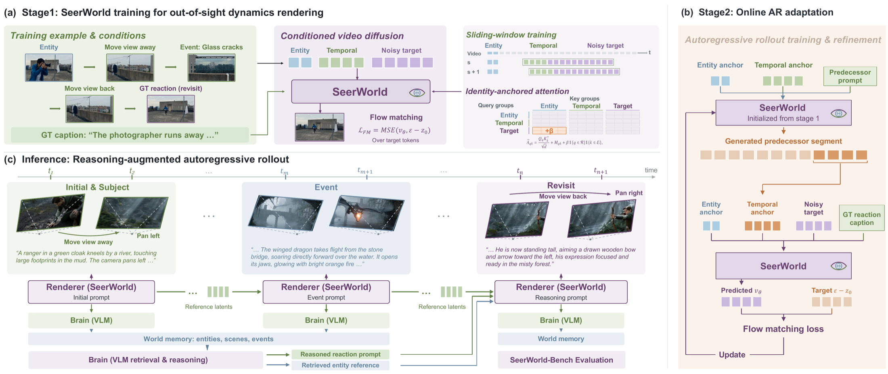
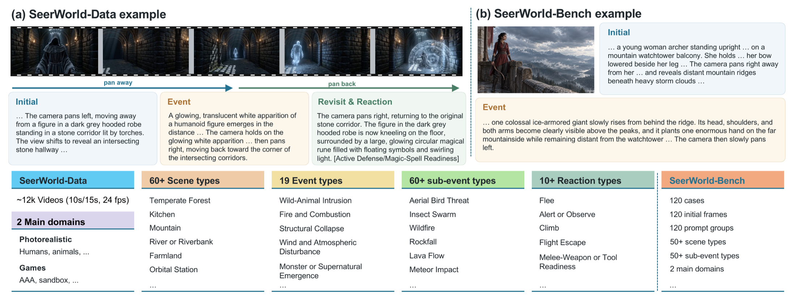

<div align="center">

# SeerWorld: Towards Out-of-Sight World Evolution in Generative Video Models

**Yequan Bie · Dengyang Jiang · Zhixuan Chen · Xiaozhuan Liang · Haoxuan Che · Eric Liu · Xi Chen · Hao Chen**

[](https://tommy-bie.github.io/projects/seerworld/)
[](https://huggingface.co/datasets/Tommy-Bie/SeerWorld-Data)


SeerWorld enables entities to remain active participants in an evolving world,
including while they are outside the current field of view.

</div>

## 🔥 News

- **2026-10-14:** SeerWorld-Data and its ready-to-train LTX-2.5 preprocessing cache are available on [Hugging Face](https://huggingface.co/datasets/Tommy-Bie/SeerWorld-Data).
- **Coming soon:** paper, SeerWorld checkpoints, SeerWorld-Bench, and the public release of this repository.

## 🌍 Overview

Existing video world models often treat off-screen entities as static visual
memory. SeerWorld instead combines a VLM brain with an autoregressive visual
renderer: the brain records generated observations and reasons about world
evolution, while identity-anchored attention and online rollout training help
the renderer preserve and update entities across long camera transitions.



The release contains:

- **SeerWorld-Data:** 12,118 structured videos with global and segment prompts.
- **Identity-Anchored Attention (IAA):** strengthens access to entity-reference tokens during revisit generation.
- **Two-stage training:** Stage 1 learns event/revisit windows; Stage 2 performs online one-hop rollout training.
- **Portable training cache:** users can train directly from released LTX-2.5 latents and prompt embeddings without repeating preprocessing.



## 📦 Release Status

| Component | Status | Link |
| --- | --- | --- |
| SeerWorld-Data | Available | [Hugging Face](https://huggingface.co/datasets/Tommy-Bie/SeerWorld-Data) |
| Preprocessed LTX-2.5 training cache | Available with the dataset | [Instructions](docs/DATA.md) |
| Stage-1 and Stage-2 training code | Available in this repository | [Quick Start](#-quick-start) |
| Paper | Coming soon | — |
| SeerWorld checkpoints | Coming soon | — |
| SeerWorld-Bench | Coming soon | — |
| General-purpose inference CLI | In preparation | — |

## 🛠️ Installation

The verified environment uses Linux, Python 3.10.20, PyTorch 2.13.0+cu132,
and an NVIDIA GPU. We recommend [uv](https://docs.astral.sh/uv/):

```bash
git clone https://github.com/Tommy-Bie/SeerWorld.git
cd SeerWorld

uv sync --locked --extra natten --python 3.10.20
uv run python scripts/check_environment.py

cp scripts/env.example.sh .env
```

The repository includes the modified LTX workspace packages needed by
SeerWorld. Do not install Diffusers for this training path. Exact verified
versions are recorded in [docs/TRAINING_ENVIRONMENT.md](docs/TRAINING_ENVIRONMENT.md).

## 🧱 Base Model Download

SeerWorld is trained from **LTX-2.5**. First accept the model terms on Hugging
Face, then download the official components:

```bash
hf auth login

hf download Lightricks/LTX-2.5 \
  diffusion_models/ltx-2.5-22b-dev-transformer-bf16.safetensors \
  text_encoders/gemma4-12b-with-proj-ltx-2.5-bf16.safetensors \
  vae/ltx-2.5-video-vae-bf16.safetensors \
  vae/ltx-2.5-audio-vae-bf16.safetensors \
  loras/ltx-2.5-22b-distilled-lora-450-bf16.safetensors \
  --local-dir models/ltx-2.5
```

Set the corresponding paths in `.env`:

| Variable | LTX-2.5 component |
| --- | --- |
| `CW_CKPT` | `diffusion_models/ltx-2.5-22b-dev-transformer-bf16.safetensors` |
| `CW_GEMMA` | `text_encoders/gemma4-12b-with-proj-ltx-2.5-bf16.safetensors` |
| `CW_VIDEO_VAE` | `vae/ltx-2.5-video-vae-bf16.safetensors` |
| `CW_AUDIO_VAE` | `vae/ltx-2.5-audio-vae-bf16.safetensors` |
| `CW_DISTILLED_LORA` | `loras/ltx-2.5-22b-distilled-lora-450-bf16.safetensors` |

For upstream model documentation, see the official
[LTX-2 code repository](https://github.com/Lightricks/LTX-2) and
[LTX-2.5 model repository](https://huggingface.co/Lightricks/LTX-2.5).

## 📚 Dataset and Training Cache

The simplest training path uses the released preprocessing cache and does not
require downloading or decoding the raw MP4 videos. Request access to the gated
[SeerWorld-Data repository](https://huggingface.co/datasets/Tommy-Bie/SeerWorld-Data),
authenticate, and run:

```bash
hf auth login
export HF_XET_HIGH_PERFORMANCE=1

# Optional: verify the remote path with one core and one condition shard.
uv run python scripts/download_training_cache.py \
  --dataset-dir /path/to/SeerWorld-Data --smoke

# Full resumable download, SHA-256 verification, and safe extraction.
uv run python scripts/download_training_cache.py \
  --dataset-dir /path/to/SeerWorld-Data

source .env
source /path/to/SeerWorld-Data/.env.cache
```

Archives are removed after successful extraction by default to avoid requiring
space for both forms. See [docs/DATA.md](docs/DATA.md) for the complete data
layout, manual download options, and preprocessing contract.

## 🚀 Quick Start

### 1. Validate Stage 1

This two-step smoke run checks model loading, real cache samples, IAA,
backpropagation, optimizer updates, and checkpoint saving:

```bash
source .env
source /path/to/SeerWorld-Data/.env.cache
bash scripts/smoke_stage1.sh
```

### 2. Validate Stage 2

Point `CW_STAGE1_LORA` to the checkpoint produced above, then validate one
online rollout/training step:

```bash
export CW_STAGE1_LORA=/path/to/lora_weights_step_00002.safetensors
bash scripts/smoke_stage2.sh
```

### 3. Train SeerWorld

```bash
# Stage 1: IAA training
bash scripts/train_stage1.sh

# Stage 2: online event-to-revisit rollout training
export CW_STAGE1_LORA="$CW_OUTPUT_ROOT/seerworld_stage1_iaafix/checkpoints/lora_weights_step_08000.safetensors"
bash scripts/train_stage2.sh
```

The paper recipe uses Stage-1 rank/alpha 128, learning rate `1e-4`, 8,000
steps, revisit oversampling 3, and IAA beta 3.0. Stage 2 uses a distilled
8-step predecessor rollout, learning rate `2e-5`, GT-prefix mixture 0.25, and
up to 2,048 selected pairs. The reported full method uses the **Stage-2
step-200 checkpoint**.

## ⚙️ Configuration

| Variable | Purpose | Default recipe |
| --- | --- | --- |
| `CW_NPROC` | Number of training processes/GPUs | `8` |
| `CW_OUTPUT_ROOT` | Checkpoint and log root | `./outputs` |
| `CW_USE_IAA` | Enable identity-anchored attention | `1` |
| `CW_IAA_BETA` | Entity-key attention bias | `3.0` |
| `CW_IAA_ENTITY_REFS` | Temporal entity-reference latents | `2` |
| `CW_STAGE1_LORA` | Stage-1 adapter used to initialize Stage 2 | required for Stage 2 |

Training uses two temporal entity-reference latents. I2V benchmark inference
uses a single-frame reference.

## 📁 Repository Structure

```text
SeerWorld/
├── seerworld/              # IAA, datasets, two-stage training, inference modules
├── packages/               # vendored LTX core, pipelines, and trainer
├── scripts/                # setup, cache download, smoke tests, launchers
├── configs/                # portable Stage-1 configuration
├── docs/                   # data and environment documentation
└── tests/                  # release and cache-workflow tests
```

## ✅ Verification

```bash
uv run python scripts/check_release.py
uv run python seerworld/test_iaa_layout.py
uv run python -m unittest discover -s tests

# Requires the GPU training environment:
uv run python seerworld/verify_iaa_runtime.py
```

The released cache download path, every cache shard, and both GPU smoke runs
have been validated from a fresh authenticated download. See
[docs/RELEASE_STATUS.md](docs/RELEASE_STATUS.md) for the recorded scope.

## 🎬 Inference and Evaluation

The repository retains the research VLM-brain and autoregressive-renderer
modules under `seerworld/inference/`. A polished public image-and-prompt CLI,
SeerWorld checkpoints, and the SeerWorld-Bench evaluation wrapper will be added
with their corresponding releases. The current release is primarily the
verified training implementation.

## 📝 Citation

Citation information will be added when the paper becomes publicly available.

```bibtex
@article{seerworld2026,
  title  = {SeerWorld: Towards Out-of-Sight World Evolution in Generative Video Models},
  author = {Bie, Yequan and Jiang, Dengyang and Chen, Zhixuan and Liang, Xiaozhuan and
            Che, Haoxuan and Liu, Eric and Chen, Xi and Chen, Hao},
  year   = {2026},
  note   = {Preprint}
}
```

## 🙏 Acknowledgements

SeerWorld is built on [LTX-2](https://github.com/Lightricks/LTX-2). We thank
the Lightricks team and the broader open-source video-generation community for
their contributions.

## 📄 License

Original SeerWorld code is released under the Apache License 2.0; see
[LICENSE](LICENSE). Vendored or modified LTX-2 components under `packages/`,
and SeerWorld components that constitute derivatives of LTX-2.x, remain
subject to the [LTX-2.x Community License Agreement](licenses/LTX-LICENSE.md).
See [NOTICE](NOTICE) for attribution and modification details. Dataset and
model-weight licenses are separate.
